<p align="center">Token-efficient agentic TypeScript runtime</p>

<p align="center">
  <a href="https://www.npmjs.com/package/flint"></a>
  <a href="https://github.com/DizzyMii/flint/actions/workflows/ci.yml"></a>
  <a href="https://img.shields.io/badge/license-MIT-blue"></a>
  <a href="https://img.shields.io/badge/node-%E2%89%A520-brightgreen">=20"></a>
  <a href="https://img.shields.io/badge/TypeScript-5.7-blue"></a>
</p>

<p align="center">
  <a href="https://dizzymii.github.io/flint">Docs</a> ·
  <a href="https://dizzymii.github.io/flint/primitives/call">API Reference</a> ·
  <a href="https://dizzymii.github.io/flint/examples/basic-call">Examples</a>
</p>

---

Six primitives. One agent loop. No magic. **Flint** gives you well-typed building blocks for AI agents in TypeScript and stays out of the way — plain async functions over the provider API, one runtime dependency, errors returned as values instead of thrown.

## Install

```sh
npm install flint @flint/adapter-anthropic
```

ESM only, Node 20+, `strict: true`. The Anthropic adapter reads `ANTHROPIC_API_KEY` from the environment. See the [setup guide](https://dizzymii.github.io/Flint/guide/) for tsconfig and `.env` details.

## Quick start

```ts
import { call, tool, agent } from 'flint';
import { budget } from 'flint/budget';
import { anthropicAdapter } from '@flint/adapter-anthropic';
import * as v from 'valibot'; // any Standard Schema library works

const adapter = anthropicAdapter({ apiKey: process.env.ANTHROPIC_API_KEY! });

// One-shot call — errors come back as values, nothing throws
const res = await call({
  adapter,
  model: 'claude-opus-5-5',
  messages: [{ role: 'user', content: 'What is the capital of France?' }],
});
if (res.ok) console.log(res.value.message.content); // "Paris"

// A tool
const add = tool({
  name: 'add',
  description: 'Add two numbers',
  input: v.object({ a: v.number(), b: v.number() }),
  handler: ({ a, b }) => a + b,
});

// Agent loop with enforced step / token / dollar caps
const out = await agent({
  adapter,
  model: 'claude-opus-5-5',
  messages: [{ role: 'user', content: 'What is 123 + 456?' }],
  tools: [add],
  budget: budget({ maxSteps: 5, maxDollars: 0.10 }), // enforced before each call, not after
});
if (out.ok) console.log(out.value.message.content); // "579"
```

## Why it is cheaper

On a scripted 30-step tool-using run against a simulator of Anthropic's prompt-cache billing (`packages/adapter-anthropic/test/bench.test.ts`, a CI gate):

| Layout | $/task |
|---|---|
| No caching | $3.08 |
| System + tools cached (typical) | $2.56 |
| **Flint rolling breakpoints** | **$0.45** |

Flint keeps every request's prefix byte-stable and places cache breakpoints so each step reads the whole history from cache. Compaction is a cost decision (`compactionDecision`), not a reflex: with caching on, re-reading history is usually cheaper than summarizing it.

## What you get

**Core (`flint`)** — 1 runtime dependency (`@standard-schema/spec`)

- 6 primitives: `call`, `stream`, `validate`, `tool`, `execute`, `count`
- `agent()` loop built on an event log (`agentStream`, `onEvent`) — stream it, trace it, resume it after a crash
- budgets enforced before each call: `max_tokens` is clamped to what is left, dollar limits fail closed if a model cannot be priced
- classified provider errors with automatic retries (rate limits, overload, retry-after)
- cost-aware, prefix-stable `contextManager()` for long runs
- record/replay cassettes for deterministic agent tests
- compress transforms + `pipeline()`: `dedup`, `windowLast`, `windowFirst`, `truncateToolResults`, `summarize`, `orderForCache`
- recipes: `react`, `retryValidate`, `reflect`, `summarize`
- RAG (chunk, store, retrieve), conversation memory with async summarization
- safety: injection detection, redaction, permissions, approval gates, boundary wrapping

## Packages

| Package | Description |
|---|---|
| `flint` | Core primitives, agent loop, compress, memory, RAG, safety, recipes |
| `@flint/adapter-anthropic` | Anthropic Messages API — prompt-cache aware |
| `@flint/adapter-openai-compat` | Any OpenAI-compatible endpoint (OpenAI, Groq, Ollama, DeepSeek, Together) |
| `@flint/graph` | *Experimental.* State-machine workflows with fan-out/join and checkpoint resume |
| `landlord` | *Experimental.* Multi-agent orchestration — dynamic workflow runtime and auto-decompose `orchestrate()` |

Adapters and graph each ship with zero runtime dependencies, on Web API primitives only (`fetch`, `ReadableStream`, `TextDecoder`).

## Why Flint

- **One dependency** — `@standard-schema/spec` only. No transitive framework sprawl.
- **No classes, no chains** — plain functions that compose naturally.
- **Standard Schema** — bring Zod, Valibot, ArkType, or any compatible library.
- **Budget-aware** — step, token, and dollar limits enforced before each call, with reservations for concurrent agents.
- **Streaming first** — `AsyncIterable<StreamChunk>` throughout, including the agent loop.
- **Safety in core** — injection detection, redaction, approval gates, abortable tools, and transcripts that are checked before they are sent.
- **Results, not exceptions** — `Promise<Result<T>>` everywhere; no try/catch at the call site.

Coming from LangChain? See the [Flint vs LangChain](https://dizzymii.github.io/Flint/guide/vs-langchain) guide for a full side-by-side.

## Documentation

Full docs at **[dizzymii.github.io/Flint](https://dizzymii.github.io/Flint)** — [primitives](https://dizzymii.github.io/Flint/primitives/call), [features](https://dizzymii.github.io/Flint/features/budget), [adapters](https://dizzymii.github.io/Flint/adapters/anthropic), [examples](https://dizzymii.github.io/Flint/examples/basic-call), [landlord](https://dizzymii.github.io/Flint/landlord/), [testing](https://dizzymii.github.io/Flint/guide/testing), and [FAQ](https://dizzymii.github.io/Flint/guide/faq).

## Contributing

See [CONTRIBUTING.md](CONTRIBUTING.md).

## License

MIT — see [LICENSE](LICENSE).
